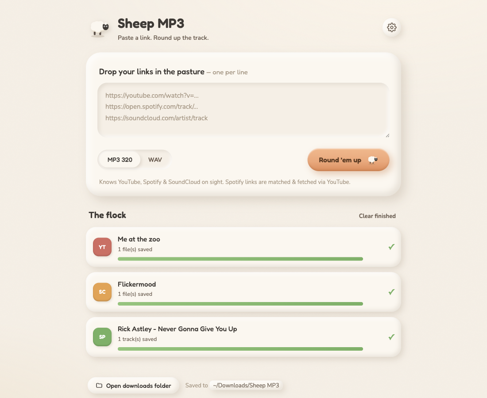

# 🐑 Sheep MP3

A cozy, beige "Shaun-the-Sheep"–styled **local web app** that turns
**YouTube, SoundCloud and Spotify** links into tidy, tagged **MP3 320 / WAV**
files. One command installs it, one command opens it.

Paste links (single tracks or whole playlists/sets/albums) → pick a format →
**Round 'em up** → files land in `~/Downloads/Sheep MP3`.



---

## Install (macOS, once)

Open **Terminal** and paste:

```bash
curl -fsSL https://raw.githubusercontent.com/Slover-69/sheep-mp3/main/install.sh | bash
```

That's it. No Homebrew, no Xcode, no sudo — everything lives in your home
folder. The installer grabs [`uv`](https://docs.astral.sh/uv/) (a tiny Python
tool manager), installs the `sheep-mp3` command with its own Python, fetches
`ffmpeg` + `deno`, and opens the dashboard. Works on Apple Silicon and Intel.

## Use

```bash
sheep-mp3            # opens http://127.0.0.1:8765 in your browser
sheep-mp3 stop       # shuts the background server down
sheep-mp3 update     # refreshes yt-dlp & friends (YouTube changes often)
sheep-mp3 status     # versions, paths, is it running
sheep-mp3 setup      # (re)download ffmpeg / deno
sheep-mp3 serve      # run in the foreground, Ctrl+C to stop
```

`sheep-mp3` starts a small background server and opens the dashboard; you can
close the Terminal window. The dashboard's **Quit** button, `sheep-mp3 stop`,
or six idle hours shut it down again.

Uninstall: `uv tool uninstall sheep-mp3` and delete
`~/Library/Application Support/SheepMP3`.

## How it works

| Source | Engine | Notes |
|--------|--------|-------|
| YouTube / SoundCloud | **yt-dlp** (Python API) | direct download, fine-grained progress |
| Spotify | **spotDL** (Python API) | Spotify is DRM-locked — spotDL reads the Spotify *metadata*, finds the match on YouTube, downloads that, and tags it |

Audio is extracted with **ffmpeg**; YouTube's player challenges are solved by
yt-dlp's EJS scripts running on **deno** (both auto-downloaded into
`~/Library/Application Support/SheepMP3/bin`). Tags + cover art are embedded;
"Artist - Title" video titles are split into proper artist/title tags and the
file is named the same way, so tracks sort correctly in Rekordbox/Serato.

```
Browser dashboard (127.0.0.1:8765)
   POST /api/jobs  +  /ws live progress
        │  link router (regex by domain)
   ┌────┴─────────────┬───────────────┐
 yt-dlp           yt-dlp            spotDL
 YouTube         SoundCloud         Spotify
        └──── ffmpeg (+ deno for YT) ────┘
        ▼   ~/Downloads/Sheep MP3/Artist - Title.mp3|wav
```

## Develop

```bash
git clone https://github.com/Slover-69/sheep-mp3 && cd sheep-mp3
uv tool install --python 3.12 --force --reinstall .   # installs the real command from this checkout
sheep-mp3 serve                                       # foreground server, frontend edits are live
```

Or without installing: `uv run --python 3.12 python -m sheep_mp3.cli serve`.
Backend edits need a restart; frontend files are served straight from
`sheep_mp3/frontend/`.

Project layout:

```
sheep_mp3/            the package
  cli.py              `sheep-mp3` command (open / serve / stop / setup / update / status)
  app.py              FastAPI routes + WebSocket + idle watchdog
  downloader.py       link router, yt-dlp / spotDL orchestration, tag cleanup
  bins.py             finds or downloads ffmpeg / ffprobe / deno
  config.py           settings JSON + paths
  frontend/           vanilla HTML/CSS/JS sheep dashboard (no build step)
install.sh            the one-line installer
assets/               icon + screenshots
```

## Caveats

- **Quality ceiling ≈ 128–256 kbps lossy** (whatever YouTube/SoundCloud serve).
  WAV is a bigger file, *not* better audio. MP3 320 is right for DJ gear.
- **YouTube changes often.** If downloads start failing, run `sheep-mp3 update`.
  If YouTube asks for a sign-in, turn on browser cookies in Settings.
- **Spotify** uses spotDL's built-in free Spotify access; heavy use may get
  rate-limited for a while.
- For **personal use** — respect artists and platform terms; buy lossless from
  Beatport/Bandcamp for real DJ masters.
